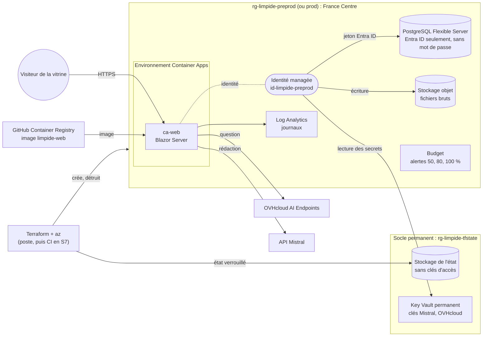

# Architecture physique de Limpide

État au 2026-10-13 (fin de la S6). Deux environnements, de nature différente (option B de la S6) :

- **la démo publique**, sur un serveur loué (OVHcloud VPS-1), installée à la main en S3 (ADR-006) ;
- **la vitrine Azure**, décrite en code (Terraform), recréée à chaque séance puis détruite (ADR-011).

Deux services extérieurs servent les deux : **Mistral** rédige les réponses (ADR-004), **OVHcloud AI Endpoints**
vectorise les questions avec Qwen3-Embedding-8B (ADR-012, révisé le 2026-10-18).

## Démo publique : https://www.limpide-ia.fr

```mermaid
flowchart LR
    V((Visiteur)) -->|HTTPS 443| C
    A((Administrateur)) -->|HTTPS 443| C
    A -.->|SSH 22, clé seule| VPS
    DNS["Zone DNS limpide-ia.fr<br/>(OVHcloud, Terraform)"] -.->|@, www, admin| VPS

    subgraph VPS["VPS OVHcloud, France : 2 vCores, 4 Go, Debian 13, pare-feu ufw (22, 80, 443)"]
        C["Caddy<br/>HTTPS Let's Encrypt"]
        C -->|8080| W["web<br/>Blazor Server"]
        C -->|8080| AD["admin<br/>back office"]
        W --> PG[("PostgreSQL 17<br/>+ pgvector")]
        AD --> PG
        I["ingestion<br/>(console .NET, à la demande)"] --> PG
        AF["Airflow allégé<br/>(ADR-013, à installer)"] -.->|lance| I
        B["sauvegarde quotidienne<br/>(minuteur systemd)"] --> PG
    end

    W -->|question| OVH["OVHcloud AI Endpoints<br/>Qwen3-Embedding-8B, France"]
    W -->|5 passages + question| M["API Mistral<br/>Medium 3.5, UE"]
    AD -->|connexion OpenID Connect| E["Microsoft Entra ID"]
    I -->|collecte polie| S["EUR-Lex (CELLAR), cnil.fr"]
    I -.->|alerte| D["Discord"]
```

- Seul Caddy est exposé ; PostgreSQL n'a pas de port publié (Docker contourne `ufw`, vérifié en S3).
- Secrets : `.env.prod` sur le serveur (droits 600) : mot de passe de la base, clés Mistral et OVHcloud, secret de
  connexion du back office.
- Coût : ≈ 4 € par mois pour le serveur, plus la consommation des API (≈ 0,5 centime par question rédigée,
  < 0,01 € par mois de vectorisation).

## Vitrine Azure (recréée à la demande)



- Aucun secret dans le code, l'état ou la configuration des conteneurs : la base n'accepte que des jetons Entra ID,
  les clés sont lues dans le coffre par la plateforme grâce à l'identité de l'application.
- Réseau : accès public filtré (règle « services Azure » et poste de l'administrateur) ; réseau privé = voie de
  production (ADR-011).
- Coût : ≈ 0,03 € de l'heure de séance ; ≈ 30 € par mois si l'environnement restait allumé (sans le conteneur
  Ollama, retiré par l'ADR-012).

## Du déploiement manuel (S3) à l'infrastructure en code (S6)

| | Démo, S3 (manuel) | Vitrine Azure, S6 (Terraform) |
|---|---|---|
| Création | commandes tapées une à une, notées dans `deploy/README.md` (≈ une session) | `./demo.sh` : 11 min 12 s, sans intervention (mesuré) |
| Recréation à l'identique | non garantie | `./detruire.sh` (13 min 5 s) puis `./demo.sh` |
| Vérification avant d'agir | aucune | `terraform plan` |
| Écarts faits à la main | invisibles | signalés au `plan` suivant |
| Secrets | fichier `.env.prod` sur le serveur | coffre Key Vault, lu par identité managée ; base sans mot de passe |
| Environnements | un | deux (préproduction, production), mêmes modules |
| Coût permanent | ≈ 4 € par mois | ≈ 30 € par mois (≈ 0,03 € de l'heure, à la demande) |
| Exploitation | système, mises à jour, sauvegardes à notre charge | aucune machine ; PostgreSQL sauvegardé par Azure |
| Ce qui est déjà en code côté démo | la zone DNS (Terraform, S6) | — |

La démo reste sur le VPS : à cette échelle, un serveur à 4 € tient le service, et la vitrine Azure montre la voie
industrialisée quand un client ou un volume l'exigera (comparatif : `docs/notes/comparatif-couts-hebergement.md`).
